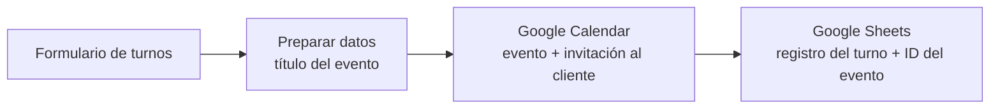

# Sistema de turnos para taller mecánico con n8n

**Español** · [English](README.md)

Automatización que reemplaza la toma manual de turnos de un taller mecánico: el cliente reserva desde un formulario y el turno queda registrado en una planilla, agendado en el calendario del taller y enviado como invitación al cliente.

> Caso de práctica basado en un taller ficticio (Taller Ruta 9). Los números de impacto son estimaciones a partir del diagnóstico del caso.

## El problema

En el taller, los turnos se pedían por teléfono y WhatsApp (unos 450 por mes). La recepcionista:

- interpretaba cada pedido (muchas veces audios o fotos), buscaba un hueco en una agenda de papel y confirmaba: ~4 minutos por turno;
- después pasaba el turno a Google Calendar para que lo vieran los mecánicos: ~1 minuto más.

Eso suma **unas 37,5 horas por mes** de trabajo manual. Además, unos 60 clientes por mes no se presentaban al turno sin avisar, con una pérdida potencial estimada en **USD 15.000 mensuales**.

## La solución

1. **Formulario:** el cliente carga nombre, teléfono, email, patente, modelo, kilometraje, tipo de turno (service o revisión), fecha, hora y una descripción opcional.
2. **Preparación de datos:** se arma el título del evento, por ejemplo `Service - AB123CD - Juan Pérez`.
3. **Google Calendar:** se crea el evento de 2 horas en el día y horario elegidos, en hora de Argentina, y se le envía una invitación al cliente.
4. **Google Sheets:** se agrega una fila con todos los datos, la fecha y hora del pedido y el ID del evento del calendario. Funciona como base de datos de turnos.

## Decisiones de diseño

- **Formulario estructurado en lugar de mensajes libres:** elimina la interpretación de audios y mensajes, y estandariza los datos desde el origen (simplificar antes de automatizar).
- **Registro de la fecha de pedido:** permite analizar con cuánta anticipación reservan los clientes y en qué momentos entra la demanda.
- **Guardar el ID del evento:** primero se crea el evento y su ID se guarda en la planilla, para poder reprogramar (PATCH) o cancelar (DELETE) el turno más adelante mediante la API de Calendar.
- **Invitación al calendario del cliente:** aporta un recordatorio adicional para reducir ausencias. No reemplaza un recordatorio propio del taller (ver próximos pasos).

## Problemas resueltos durante la construcción

- **Horas con un solo dígito:** el formulario devolvía `8:00` en lugar de `08:00`, lo que generaba fechas inválidas y rechazos de la API de Calendar. Se resolvió interpretando la fecha con un formato explícito (`DateTime.fromFormat` con `yyyy-MM-dd H:mm`).
- **Zona horaria:** los eventos se interpretan explícitamente en `America/Argentina/Buenos_Aires` para que el horario no dependa de la configuración del servidor.
- **Teléfonos sin el 0 inicial:** Google Sheets convertía el teléfono en número. Se configuró el nodo para guardar los valores sin que Google los reinterprete.
- **Autenticación con Google (OAuth 2.0):** configuración de proyecto, APIs, pantalla de consentimiento y usuarios de prueba en Google Cloud.

## Resultado esperado

| Indicador | Antes | Después |
|---|---|---|
| Tiempo de gestión de turnos | ~37,5 h/mes | Solo revisión de excepciones |
| Transcripción a calendario | Manual | Automática |
| Registro histórico de turnos | Cuaderno | Planilla con todos los datos |

## Próximos pasos

- Recordatorio automático el día anterior, con opción de confirmar o reprogramar.
- Marcar los turnos de revisión como "a confirmar" por la recepción.
- Versión alternativa con Google Forms como formulario público.
- Recordatorios por WhatsApp.

## Tecnologías

- [n8n](https://n8n.io) (autoalojado)
- Google Sheets API y Google Calendar API
- OAuth 2.0

## Cómo usarlo

1. Importar `sistema-turnos.json` en n8n (**Import from file**).
2. Crear las credenciales de Google Sheets y Google Calendar con un cliente OAuth propio.
3. Crear una planilla con las columnas: Fecha de pedido, Nombre, Teléfono, Patente, Modelo, Kilometraje, Tipo de turno, Fecha y hora del turno, Descripción, email, id_evento.
4. Elegir la planilla y el calendario en los nodos correspondientes y publicar el flujo.

---

Autor: Ignacio Erausquin, Ingeniero Industrial (UBA).
