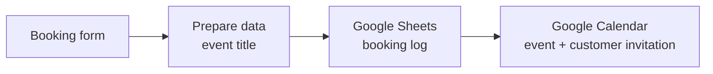

# Appointment booking system for a car repair shop, built with n8n

[Español](README.es.md) · **English**

An automation that replaces manual appointment booking at a car repair shop: the customer books through a form, and the appointment is logged in a spreadsheet, added to the shop's calendar, and sent to the customer as a calendar invitation.

> Practice case based on a fictional repair shop in Argentina (Taller Ruta 9). Impact figures are estimates from the case diagnosis. The booking form and data fields are in Spanish, the shop's language.

## The problem

The shop took about 450 booking requests a month by phone and WhatsApp. For each one, the receptionist:

- interpreted the request (often voice notes or photos), looked for a free slot in a paper diary and confirmed it: ~4 minutes per booking;
- then copied the booking into Google Calendar so the mechanics could see it: ~1 more minute.

That adds up to **about 37.5 hours a month** of manual work. On top of that, around 60 customers a month missed their appointment without notice, an estimated potential loss of **USD 15,000 a month**.

## The solution

1. **Form:** the customer enters name, phone, email, licence plate, car model, mileage, type of appointment (service or inspection), date, time and an optional description.
2. **Data preparation:** builds the event title, e.g. `Service - AB123CD - Juan Pérez`.
3. **Google Sheets:** appends a row with all the data plus the date and time of the request. It works as the shop's booking database.
4. **Google Calendar:** creates a 2-hour event on the chosen date and time, in Argentina's time zone, and sends the customer an invitation.

## Design decisions

- **A structured form instead of free-text messages:** removes the need to interpret voice notes and messages, and standardises the data at the source (simplify before automating).
- **Logging the request date:** makes it possible to analyse how far in advance customers book and when demand comes in.
- **Calendar invitation for the customer:** adds a reminder that helps reduce no-shows. It does not replace a reminder sent by the shop itself (see next steps).

## Problems solved while building it

- **Single-digit hours:** the form returned `8:00` instead of `08:00`, which produced invalid dates and rejections from the Calendar API. Fixed by parsing the date with an explicit format (`DateTime.fromFormat` with `yyyy-MM-dd H:mm`).
- **Time zone:** events are explicitly parsed in `America/Argentina/Buenos_Aires`, so times do not depend on the server's settings.
- **Phone numbers losing the leading zero:** Google Sheets was converting phone numbers into numbers. The node was set to store values without Google reinterpreting them.
- **Google authentication (OAuth 2.0):** set up the project, APIs, consent screen and test users in Google Cloud.

## Expected outcome

| Indicator | Before | After |
|---|---|---|
| Time spent managing bookings | ~37.5 h/month | Reviewing exceptions only |
| Copying bookings to the calendar | Manual | Automatic |
| Booking history | Paper diary | Spreadsheet with all the data |

## Next steps

- Automatic reminder the day before, with an option to confirm or reschedule.
- Flag inspection bookings as "to be confirmed" by the receptionist.
- Alternative version using Google Forms as the public form.
- WhatsApp reminders.

## Tech stack

- [n8n](https://n8n.io) (self-hosted)
- Google Sheets API and Google Calendar API
- OAuth 2.0

## How to use it

1. Import `sistema-turnos.json` into n8n (**Import from file**).
2. Create Google Sheets and Google Calendar credentials with your own OAuth client.
3. Create a spreadsheet with these columns: Fecha de pedido, Nombre, Teléfono, Patente, Modelo, Kilometraje, Tipo de turno, Fecha y hora del turno, Descripción, email.
4. Select the spreadsheet and the calendar in the corresponding nodes and publish the workflow.

---

Author: Ignacio Erausquin, Industrial Engineer (Universidad de Buenos Aires).
